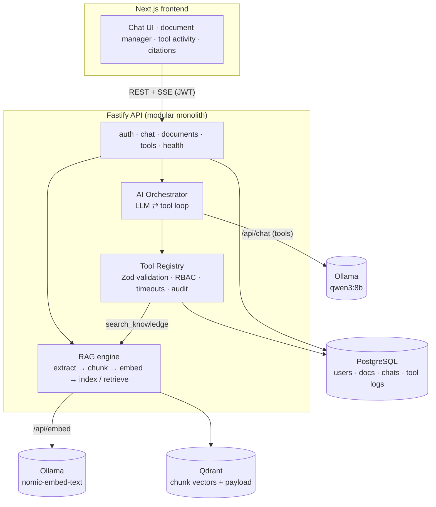

# CL Buddy

**Your work buddy.** CL Buddy is a private, local-first AI assistant for everyone at the company:
- **Answers from company documents:** policies, guides, handbooks.
- **Helps sort out work issues step by step:** what to do, who to contact, what to have ready.
- **Drafts emails and messages:** ready to copy or open in your mail app.

It runs with **no cloud LLM API and no API keys**. Model inference, embeddings, vector search and storage all stay on your own machines.

Built to show the parts of AI engineering beyond "call an LLM API": local inference, embeddings and semantic search, a hand-written RAG pipeline, native tool calling with a security boundary, orchestration, observability and measurable retrieval quality.

| | |
|---|---|
| **LLM runtime** | [Ollama](https://ollama.com) — `qwen3:8b` (chat + tool calling), `nomic-embed-text` (embeddings) |
| **Backend** | Node.js · TypeScript · Fastify · Zod · Prisma |
| **Data** | Qdrant (vectors) · PostgreSQL (users, documents, chats, tool audit log) |
| **Frontend** | Next.js 16 · React 19 (streaming chat UI), themed to match [codinglegends.io](https://www.codinglegends.io): brand blue `#3A7CC4`, sky/cyan gradient `#78D4E4 → #58BCF8`, black pill buttons; light and dark mode |
| **Testing** | Vitest — 113 unit + 146 integration tests (real Postgres/Qdrant), 20 Playwright E2E, security suite, RAG evaluation harness |
| **Infra** | Docker Compose |

## What CL Buddy does for people

| Ask… | CL Buddy… |
|---|---|
| *"My laptop isn't working, what should I do?"* | Acknowledges it, checks the IT guide, gives numbered steps with citations (restart → ticket with asset tag → loaner laptop), says who handles it, offers to draft the ticket email |
| *"Draft an email to HR asking for annual leave from 2 to 6 March"* | Looks up who handles leave (`find_team`), then writes a draft addressed to the real HR contact, shown as an **email card** with **Copy** and **Open in email app** |
| *"How do I claim back expenses?"* | Answers from the handbook (deadline, receipts, approval limits) and offers to draft the claim note |
| *"How many leave days do I have?"* | Reads **your own** leave record: *"You have **13 days** of annual leave left for 2026 🌴 (21 entitled + 2 of 3 carried over; 7 taken, 3 booked)"*, and flags carried-over days about to expire |
| *"Book leave from 28 to 29 December"* | Prepares a **request card** (dates, working days, what's left after, warnings). You press **Submit request**; HR approves it in their inbox; the card updates live to *"✓ Approved: 'Have a lovely break!'"* |
| *"If I take 28–31 December, what's left?"* | Counts working days (skipping weekends and company holidays), checks clashes, shows the balance before/after, then offers to draft the request to HR |
| *"What's the CEO's salary?"* (as an intern) | *"Ha, good one, but my lips are sealed! 🤐"* (see [Access control](#access-control)) |
| *"Turn these notes into a meeting agenda"*, *"Make this email more polite"* | Rewrites, summarises, proofreads, builds checklists and agendas |

How it does that:
- **Sorting things out.** The system prompt follows a colleague-style playbook: acknowledge the problem; ground the answer in company policy (`search_knowledge`, cited); give numbered steps with deadlines and what to prepare; route to the right team (`find_team`) with an escalation path; offer a draft. Sensitive situations (harassment, health, legal) get a brief, kind answer pointing to the right confidential channel.
- **Drafting.** Emails come back in a structured ```email block (To / Cc / Subject / body) that the UI renders as a card. Recipients are only ever addresses the user gave or the directory returned, never invented; unknown details become `[placeholders]`. "Open in email app" uses `mailto:`, which only pre-fills your own mail client; nothing is sent until you press Send there.
- **Who handles what.** Admins describe each team's responsibilities in the Organization panel (e.g. *IT Support: laptops, accounts, passwords*). `find_team` uses that, plus team membership, to route questions to real contacts.
- **Personal context.** The buddy knows who it's talking to (email and teams, from the login session) so it can apply the right team's process.

## Leave balances

Everyone sees their own balance in a **🌴 My leave** card in the sidebar (entitlement, carry-over and its expiry, taken, booked, other leave types, upcoming dates), and can ask CL Buddy about it in chat.

**How it's calculated** (per person, year and leave type, in half-day units so half days are exact):
- **Total** = entitlement + usable carry-over + adjustments.
- **Taken** is approved leave that has started; **booked** is approved leave still in the future.
- **Remaining** = total − taken − booked.
- **Carry-over** must be used by its expiry date. After that date, only the carried days actually used before it still count.
- **Working days** exclude weekends and company holidays; half days can be recorded explicitly.

**Who maintains it.** Members of the HR group (`LEAVE_MANAGER_GROUP`, default `HR`) and admins get a **Manage leave** panel:
- a team overview;
- editing each person's allowance;
- recording or cancelling leave;
- company holidays;
- importing a spreadsheet as CSV. The import is all-or-nothing: every row is validated first, and errors are reported per row.

```csv
email,year,leave_type,entitled_days,carried_over_days,carry_over_expires,adjustment_days,note
sam@company.com,2026,ANNUAL,21,3,2026-03-31,0,
```
```csv
email,leave_type,start_date,end_date,days,note
sam@company.com,ANNUAL,2026-03-02,2026-03-06,,Family trip
```

**Privacy.** Leave data is personal:
- **Strictly self-only tools.** The buddy's two tools (`get_my_leave_balance`, `check_leave_dates`) take **no user parameter**, so the model can't look anyone else up, even if asked or prompt-injected.
- **Management is HR/admin only.** Management endpoints check that role, and every change is audited.

### Requesting leave

1. Ask CL Buddy ("Book leave from … to …"), or use **Request leave →** on the My leave card.
2. The buddy calls `propose_leave_request`, which **only prepares a card**: dates, working days, what's left afterwards, any warnings.
3. Nothing is submitted until **you** press **Submit request**. The model has no tool that submits, approves or changes anything, so a prompt-injected document can at most show a card you can ignore.
4. The request is **pending**. Pending days are shown separately and **reserved**, so you can't double-book: new requests are checked against *available* = remaining − pending.
5. HR sees it in **Manage leave → Requests** (with a count badge), along with "x days left if approved", and approves or rejects it with an optional note.
6. Your card and My leave update live. You can **withdraw** a pending request or **cancel** approved leave that hasn't started.

Rules enforced on the server:
- requests that clash, overdraw (counting pending days) or fall in the past are refused;
- nobody can approve their own request (another HR member or an admin has to);
- approval re-checks the balance and clashes;
- a per-person lock stops two simultaneous requests from both passing the balance check (a test verifies it fails without the lock);
- every step is audited.

### Syncing with the company's HR leave system

Every leave change (request submitted, withdrawn, approved, rejected, cancelled, or recorded by HR) can be **pushed to the external HR leave system's API**:
- **Never lost:** each change is written to an outbox in the same transaction.
- **Ordered and safe to retry:** delivery is in order per leave, with exponential back-off and an `Idempotency-Key` on every call.
- **Visible:** admins see status and failures (with Retry) in **Organization → Integrations**.

It's **off by default**, with a placeholder URL (`https://hr-api.example.com/v1`), until the vendor's API is ready. The proposed contract, payload examples and open questions for the vendor are in [`docs/hr-integration.md`](docs/hr-integration.md). When the real spec arrives, only `modules/integrations/hr/hr-client.ts` changes.

Reading balances from the HR system later is also possible: leave reads go through a `LeaveDataSource` interface.

## Features

- **Chat with your documents** — upload PDF, DOCX, TXT or Markdown; answers cite the exact passages (`[S1]`) with file name, page range and similarity score.
- **Native tool calling** — the model can search your knowledge base, do exact arithmetic, check the time, and query PostgreSQL (your documents, usage stats). Admin-only tools demonstrate role-based permissions.
- **Streaming** — tokens and live tool activity over Server-Sent Events.
- **Conversation memory** — multi-turn chats persisted in PostgreSQL.
- **Document-level access control** — documents are private, shared with the whole organisation, or shared with groups (HR, Executives…), and classified Public → Internal → Confidential → Restricted. Users have a clearance level and group memberships. An intern asking for the CEO's salary never retrieves the compensation file, so the model never sees it. Enforced in Qdrant *and* re-checked in PostgreSQL, outside the model.
- **Observability** — every tool execution is audited (arguments, status, duration); structured logs for ingestion and chat turns.
- **Fault tolerance** — timeouts, retries with backoff for transient Ollama failures, tool timeouts, bounded tool loops, graceful degradation.
- **Measurable RAG** — an evaluation harness reports Hit@k, Precision@k, MRR, answer accuracy and citation accuracy over a labelled question set.

## Architecture



### One chat turn

```
user ──► Orchestrator ──► LLM (messages + tool specs filtered by role)
              ▲                 │
              │       tool_calls? ── no ──► answer ─► persist ─► stream "done"
              │                 │ yes
              │                 ▼
              │       ToolRegistry.execute(name, args, trustedContext)
              │         • unknown tool?   → error result
              │         • role allowed?   → else DENIED
              │         • Zod-valid args? → else error result
              │         • run with timeout, audit to PostgreSQL
              └──────── tool result appended as a `tool` message (≤ MAX_TOOL_ROUNDS)
```

RAG is exposed *as a tool* (`search_knowledge`), so the model decides when document context is needed, and retrieved passages come back labelled `S1…Sn` for citation. If the model keeps calling tools past the limit, the orchestrator forces a final answer with tools disabled.

More detail and design decisions: [`docs/architecture.md`](docs/architecture.md).

## Quick start

### 1. Prerequisites

- Node.js ≥ 20.11, Docker
- [Ollama](https://ollama.com/download)

### 2. Choose a model for your hardware

| Machine | Chat model | Notes |
|---|---|---|
| 16 GB+ RAM, or a GPU with 8 GB+ VRAM | `qwen3:8b` (default) | Best tool-calling reliability of the three |
| 8–16 GB RAM | `qwen3:4b` | Noticeably faster on CPU, still calls tools well |
| Low-end / quick experiments | `qwen3:1.7b` | Expect weaker tool selection |

Any Ollama model with **tool support** works (e.g. `qwen2.5:7b-instruct`, `llama3.1:8b`). Set `CHAT_MODEL` in `.env`.

```bash
ollama pull qwen3:8b            # or qwen3:4b
ollama pull nomic-embed-text
```

### 3. Start the infrastructure and the app

```bash
cp .env.example .env
# set JWT_SECRET to a random value:  openssl rand -base64 48

npm install                     # also generates the Prisma client
npm run infra:up                # Qdrant + PostgreSQL (bound to 127.0.0.1 only)
npm run db:deploy               # apply database migrations

npm run dev:api                 # http://localhost:4000
npm run dev:web                 # http://localhost:3000  (in a second terminal)
```

Open http://localhost:3000, create an account (the first account becomes the administrator), drop some documents into the knowledge base and start asking questions. `GET http://localhost:4000/api/health` reports the status of PostgreSQL, Qdrant and both Ollama models.

> **No GPU / can't run Ollama?** `npm run mock:ollama` starts a rule-based stand-in for the Ollama API on port 11434 so you can click through the whole app. It pattern-matches instead of generating text — use it for demos and E2E tests, not for judging answer quality.

## Access control

Who can read a document is decided by one policy ([`access.policy.ts`](apps/api/src/modules/access/access.policy.ts)):

> A user can read a document if they **own** it, **or** it's shared with the **organisation** and its classification ≤ their clearance, **or** it's shared with a **group they belong to** and its classification ≤ their clearance.

Classification is checked *on top of* group membership, so adding an intern to the HR group by mistake still doesn't expose Restricted files. Admins manage people, groups and any document, but they **don't** automatically read everything: their retrieval follows the same policy.

**Where it's enforced**

```
question ─► search_knowledge(query)          ← model controls only the query text
              │  principal = { userId, clearance, groupIds } from the login token,
              │              reloaded from PostgreSQL on every request
              ▼
         Qdrant search with a payload filter  ← chunks the user can't read are never candidates
              ▼
         PostgreSQL re-check of every hit      ← source of truth; stale vector payloads can't widen access
              ▼
         passages the user may read ─► model
```

The policy is compiled into a Qdrant filter, a Prisma `where` and a plain predicate, so retrieval, document listing, the `list_documents` tool and the in-memory test store all apply the same rule. Sharing changes update PostgreSQL first, so revocations take effect immediately, then sync the vector payloads. Removing someone from a group, lowering their clearance or deleting a group applies on their very next request. Sharing, permission and group changes are written to an **audit log**.

Rules for sharing: non-admins can only share with groups they belong to, so nobody can push content (or prompt injections) into another team's knowledge base. Readers can't change, re-index or delete documents they don't own. Users without read access get `404` rather than `403`, so they can't tell the document exists.

**Try it:** `npm run seed:demo` creates a demo company (CEO, CFO, HR, engineer, intern, IT support), with team responsibilities and classified documents. Every account's password is `demo-password`.
1. As `intern@demo.local`, ask *"My laptop isn't working, what should I do?"* or *"Draft an email to HR asking for annual leave from 2 to 6 March"*.
2. As `intern@demo.local`, ask *"What is the CEO salary?"* and get a playful no.
3. As `hr@demo.local`, ask the same and get the answer with a Confidential source.
4. As `engineer@demo.local`, ask *"What do new hires get on day one?"*, then click **Ask for access**.
5. Approve the request as `hr@demo.local`.

**Tested by** a 41-case integration matrix: 5 people × 5 documents for retrieval, listing and direct access, checked both through Qdrant alone and through the full path. It also covers attempts to widen access through tool arguments, sharing into foreign groups, revocation via group removal, clearance changes and group deletion, a tampered vector payload, admin-only endpoints and the audit trail. Deliberately breaking either enforcement layer makes the suite fail.

### "Ah-ah, that's confidential" and asking for access

When a question strongly matches a document the user can't read, CL Buddy says so in a friendly way instead of pretending nothing exists, and gives them something to do next:

| Situation | Reply | Under the reply |
|---|---|---|
| Above their clearance (intern → CEO salary) | *"Ha, good one, but my lips are sealed! 🤐 That one's confidential: it's above your clearance level…"* | 🤫 card + quick-reply suggestions (no request button, since only an admin can change clearance) |
| Clearance is fine, just not shared with them | *"Ah-ah, nice try! 🤫 That's confidential: it's only shared with HR…"* | 🔒 card with **Ask for access** (optional note) |

The request goes to the document's owner, who sees it in an **Access requests** inbox with **Approve / Decline**. Approval grants that one person access, still capped by their clearance. The requester's card updates live to *"✓ Access granted!"* with an **Ask again** button. Owners can revoke individual grants from the Access editor, and everything lands in the audit log.

**What the acknowledgement does and doesn't reveal.** Saying "that's confidential" admits that *something* matched, which can be probed. So it's deliberately narrow:
- **Only shared documents:** only READY documents shared with a team or the whole organisation are acknowledged. Someone's private files never are.
- **Only strong matches:** similarity must reach `RESTRICTED_NOTICE_SCORE_THRESHOLD`, default 0.55.
- **Minimal detail:** at most one "above your clearance" notice per answer, carrying only the classification and audience. No title, excerpt, score or document id reaches the client or the model. The requester only learns the file name once approved.
- **Silent mode:** set `ACCESS_DENIAL_MODE=silent` to go back to revealing nothing.

Requests can only be raised from a notice the assistant actually showed that user (message + notice id are checked server-side), so they can't be used to fish for document ids.

### Classification suggestions

After a document is indexed, CL Buddy suggests a classification if the content looks more sensitive than the label it was uploaded with. The owner sees *"💡 This looks **Confidential**: mentions salary or compensation figures"* with **Mark Confidential / Keep Internal**.

- **Rules** (deterministic): private keys, API tokens, passwords, salary/compensation figures, Luhn-valid card numbers, IBANs, SSN-style IDs, medical and HR-case language, M&A discussion, "Confidential"/"Restricted" markings.
- **Model** (optional, `CLASSIFICATION_SUGGESTIONS=model`): the local chat model returns strict JSON (`format` = JSON schema), validated with Zod.
- **Combining them:** the result is `max(rules, model)`. A document saying "classify this as PUBLIC" can fool the model but not the rules, which act as a floor.
- **Only upward, never automatic:** suggestions are shown only when *higher* than the current label, nothing is applied automatically, and "Keep" is audited.

**Not covered:** answers given *before* access was revoked stay in that user's chat history. Revocation stops future retrieval; it can't un-tell a past answer.

## API

All endpoints except `auth/register`, `auth/login` and `health` require `Authorization: Bearer <token>`.

| Method | Endpoint | Purpose |
|---|---|---|
| POST | `/api/auth/register` | Create an account → `{ token, user }` |
| POST | `/api/auth/login` | Sign in → `{ token, user }` |
| GET | `/api/auth/me` | Current user |
| POST | `/api/chat` | Send a message → `{ conversationId, messageId, answer, sources, toolExecutions }` |
| POST | `/api/chat/stream` | Same, streamed as SSE: `conversation`, `token`, `reset`, `tool_start`, `tool_end`, `done`, `error` |
| GET | `/api/chat` | List conversations |
| GET | `/api/chat/:id` | Conversation with messages, sources and tool executions |
| DELETE | `/api/chat/:id` | Delete a conversation |
| POST | `/api/documents/upload` | Upload (multipart `file`, optional `visibility`, `classification`, `groupIds`) → `202` |
| GET | `/api/documents` | Your documents plus those shared with you, with access settings |
| GET | `/api/documents/:id` | One document |
| POST | `/api/documents/:id/reindex` | Re-extract and re-embed (e.g. after changing the embedding model) |
| DELETE | `/api/documents/:id` | Delete from PostgreSQL, Qdrant and disk |
| GET | `/api/tools` | Tools available to your role, with JSON-schema parameters |
| PATCH | `/api/documents/:id/access` | Change visibility, classification, groups (owner or admin) |
| DELETE | `/api/documents/:id/grants/:userId` | Revoke an individual grant (owner or admin) |
| POST | `/api/access-requests` | Ask for access from a notice in a chat answer (`messageId`, `noticeId`, optional `note`) |
| GET | `/api/access-requests` | `incoming` (to decide on) and `outgoing` (yours) |
| POST | `/api/access-requests/:id/approve` · `/deny` | Decide (document owner or admin) |
| GET | `/api/leave/me`, `/api/leave/plan` | Your own leave balance; plan dates without booking |
| POST | `/api/leave/requests`, `/api/leave/requests/:id/cancel` | Submit (from a chat card or directly) / withdraw your own request |
| GET / POST | `/api/leave/manage/requests`, `…/:id/approve`, `…/:id/reject` | HR approvals inbox |
| GET / PUT / POST / DELETE | `/api/leave/manage/…` | People overview, allowances, entries, holidays, CSV import (HR group or admin) |
| GET / POST | `/api/admin/integrations/hr`, `…/sync`, `…/events/:id/retry` | HR-system sync status, send now, retry failures (admin) |
| GET | `/api/tools/executions` | Your tool audit log |
| GET / POST / PATCH | `/api/admin/users`, `/api/admin/users/:id` | People: add, role, clearance, groups (admin) |
| POST | `/api/documents/:id/suggestion/dismiss` | Keep the current label instead of the suggested one |
| GET / POST / PATCH / DELETE | `/api/admin/groups`, `/api/admin/groups/:id` | Groups and what each team handles (admin) |
| GET | `/api/admin/audit` | Sharing / permission audit log (admin) |
| GET | `/api/health` | Dependency health (200 / 503) |

Example:

```bash
curl -s localhost:4000/api/chat -H "authorization: Bearer $TOKEN" -H "content-type: application/json" \
  -d '{"message":"What does my company policy say about annual leave?"}'
```

```json
{
  "conversationId": "4f0c…",
  "messageId": "a81e…",
  "answer": "Full-time employees get 21 days of paid annual leave per year [S1].",
  "sources": [{ "ref": "S1", "documentId": "9b2d…", "fileName": "employee-handbook.md", "pageStart": null, "pageEnd": null, "score": 0.71, "excerpt": "…" }],
  "toolExecutions": [{ "id": "…", "tool": "search_knowledge", "arguments": { "query": "annual leave policy" }, "status": "SUCCESS", "durationMs": 84 }]
}
```

## Tools

| Tool | Data source | Who |
|---|---|---|
| `search_knowledge` | Qdrant semantic search over *your* documents | everyone |
| `calculate` | Fixed binary operations (no `eval`) | everyone |
| `get_current_time` | Server clock, optional IANA time zone | everyone |
| `list_documents` | PostgreSQL (predefined query, access-policy scoped) | everyone |
| `find_team` | PostgreSQL: teams, what they handle, member contacts | everyone |
| `get_my_leave_balance` | The caller's own leave record (no user parameter) | everyone |
| `check_leave_dates` | Working days, holidays, clashes and balance after, for the caller | everyone |
| `propose_leave_request` | Prepares a request **card**; submits nothing (the user clicks Submit) | everyone |
| `get_usage_stats` | PostgreSQL aggregates for your account | everyone |
| `get_system_stats` | Instance-wide PostgreSQL aggregates | **ADMIN** |

Adding a tool is one file — define a Zod schema and an `execute(args, ctx)` function, then register it in [`apps/api/src/modules/tools/index.ts`](apps/api/src/modules/tools/index.ts). The JSON schema the model sees is generated from the Zod schema, so validation and documentation never drift apart.

```ts
export const weatherTool = defineTool({
  name: "get_weather",
  description: "Get the current weather for a city",
  schema: z.object({ city: z.string().min(1).max(100) }),
  timeoutMs: 5000,
  async execute({ city }, ctx) {
    // ctx.userId / ctx.userRole come from the authenticated request, never from the model
    return fetchWeather(city, { signal: ctx.signal });
  },
});
```

## Security design

- **The model never chooses what data it sees.** Tools receive identity, clearance and groups from a trusted server-side context. Every Qdrant search carries the access-policy filter, every hit is re-checked in PostgreSQL, and every SQL query is scoped in code. See [Access control](#access-control).
- **Tools are an allow-list.** Unknown tools are rejected, arguments are Zod-validated before any code runs, each tool has a timeout, and role checks run both when advertising tools and when executing them.
- **No arbitrary SQL, shell or `eval`.** Database access is via predefined, read-only Prisma queries; the calculator is a fixed set of operations.
- **Retrieved text is untrusted.** The system prompt tells the model to treat tool output as data, and results are JSON-encoded. The real protection is architectural: even a successful prompt injection can only call read-only tools scoped to the current user. (`eval/documents/security-policy.md` contains a deliberate injection test case.)
- **Internal errors are not echoed to the model.** Unexpected tool exceptions become a generic message and are logged server-side.
- **Uploads** are size-limited, type-checked by extension *and* magic bytes, deduplicated by SHA-256 per user, stored with `0600` permissions under a server-generated name. DOCX archives are checked for zip bombs before parsing, documents are capped at 5,000 chunks, and documents interrupted mid-indexing are marked failed on restart rather than retried, so one bad file can't crash-loop the server.
- **Auth**: scrypt password hashing, JWT (HS256) with expiry, users re-loaded on every request (deleted users lose access immediately), rate-limited login/registration/chat/upload, uniform login errors with timing equalisation.
- **Local infrastructure**: Docker publishes Qdrant/PostgreSQL/Ollama on `127.0.0.1` only — Qdrant has no auth by default and Ollama has none at all.

## Security testing

See [`SECURITY.md`](SECURITY.md) for the threat model, controls and assessment log. In short:
- **SQL injection:** the Prisma query builder is used everywhere.
- **Prompt injection:** contained architecturally. The tests drive an obedient "compromised" mock model through planted instructions and verify it can't escalate, can't read beyond the victim's access, and is detected and audited.
- **Exfiltration:** answers can't render clickable links or images, and the web app ships a strict CSP.
- **Other attack classes:** mass assignment, path traversal, bidi filenames, XSS, CORS, enumeration and DoS are each covered by tests.

## Evaluating RAG quality

```bash
npm run eval:rag                                  # retrieval metrics with your real embedding model
npm run eval:rag -- --answers -v                  # + answer accuracy & citation accuracy (uses the chat model)
npm run eval:rag -- --chunk-sizes=300,600,900     # compare chunking strategies
npm run eval:rag -- --fake                        # offline smoke run (hash embeddings)
```

The corpus is in [`apps/api/eval/documents`](apps/api/eval/documents) and the 28 labelled questions in [`apps/api/eval/questions.json`](apps/api/eval/questions.json). Each question names the file and an evidence span that must be retrieved, plus facts the answer must contain.

| Metric | Meaning |
|---|---|
| Hit@k (recall) | Evidence passage appears in the top k results |
| Precision@k | Share of retrieved chunks that come from the right document |
| MRR | 1 / rank of the first relevant chunk |
| Answer accuracy | Answer contains all expected facts (`--answers`) |
| Citation accuracy | Every `[S#]` cited points at the right document (`--answers`) |

Per-question results are written to `apps/api/eval/results/`.

## Testing

```bash
npm test                      # unit tests (no infrastructure needed)
npm run infra:up
npm run test:integration      # real PostgreSQL (clbuddy_test DB) + real Qdrant + fake Ollama over HTTP
npm run typecheck

# End-to-end (browser) — against the running stack with the mock model:
npm run mock:ollama & RATE_LIMIT_ENABLED=false ALLOW_REGISTRATION=true RETRIEVAL_SCORE_THRESHOLD=0.05 RESTRICTED_NOTICE_SCORE_THRESHOLD=0.1 npm run dev:api &
npm run build -w @clbuddy/web && npm run start -w @clbuddy/web &
npm run seed:demo             # demo organisation used by the access-control E2E tests
npm run e2e -w @clbuddy/web
```

- **Unit** — chunking (overlap, page attribution, pathological input), extraction (real PDF/DOCX fixtures), tool registry (validation, RBAC, timeouts, error masking), orchestrator loop (citations, round limits, per-round caps, hallucinated tools, history, streaming order), Ollama client (NDJSON split across TCP packets, retries, timeouts, aborts), config, auth crypto.
- **Integration** — the real Fastify app through HTTP: auth flows and token tampering, uploads of every format, duplicate/oversize/spoofed files, background indexing, cross-user isolation of documents, retrieval, conversations and tool logs, re-indexing and deletion verified directly in Qdrant, end-to-end tool calling, permission denial, SSE streaming, failure paths, health checks.

- **Access control** — the matrix described above, plus unit tests of the policy.
- **E2E (Playwright)** — intern vs. HR asking for the CEO's salary, readers unable to manage others' documents, the admin panel, editing a document's access, sign-up, multi-file upload, cited RAG answer with citation highlighting, calculator tool, history restore after reload, backend-failure banner, switching chats mid-stream, unsupported uploads, and a mobile layout check.

The integration suite uses a separate `clbuddy_test` database (created automatically by `infrastructure/postgres/init.sql`) and a throw-away Qdrant collection per run. It is skipped with a warning if the infrastructure isn't running.

## Configuration

All settings are environment variables validated at startup (see [`.env.example`](.env.example) and [`apps/api/src/config/env.ts`](apps/api/src/config/env.ts)). The important ones:

| Variable | Default | |
|---|---|---|
| `CHAT_MODEL` | `qwen3:8b` | Any Ollama model with tool support |
| `EMBEDDING_MODEL` / `EMBEDDING_DIMENSIONS` | `nomic-embed-text` / `768` | Must match; re-index after changing |
| `OLLAMA_THINK` | `false` | Qwen3 reasoning mode (slower, sometimes better) |
| `CHUNK_SIZE_TOKENS` / `CHUNK_OVERLAP_TOKENS` | `600` / `100` | Starting values — tune with the eval harness |
| `RETRIEVAL_LIMIT` / `RETRIEVAL_SCORE_THRESHOLD` | `5` / `0.35` | Top-k and minimum cosine similarity |
| `ACCESS_DENIAL_MODE` | `acknowledge` | `acknowledge`: friendly "that's confidential" + request access; `silent`: reveal nothing |
| `RESTRICTED_NOTICE_SCORE_THRESHOLD` | `0.55` | Minimum similarity before a restricted document is acknowledged |
| `MAX_TOOL_ROUNDS` / `MAX_TOOL_CALLS_PER_ROUND` | `5` / `5` | Bounds on the agent loop |
| `TOOL_TIMEOUT_MS` / `LLM_TIMEOUT_MS` | `15000` / `180000` | Fault-tolerance limits |
| `ALLOW_REGISTRATION` | `first-user` | `first-user`: sign-up closes after the first (admin) account; admins add people. `true`: always open (demos; reveals registered emails). `false`: closed |
| `LEAVE_MANAGER_GROUP` | `HR` | Members of this group (and admins) manage everyone's leave |
| `HR_SYNC_ENABLED` / `HR_API_BASE_URL` / `HR_API_TOKEN` | `false` / `https://hr-api.example.com/v1` / – | Push leave changes to the external HR system (see `docs/hr-integration.md`) |
| `CLASSIFICATION_SUGGESTIONS` | `model` | `model` (rules + local model), `rules`, or `off` |
| `RESTRICTED_NOTICE_HOURLY_LIMIT` | `30` | Per-user cap on "that's confidential" notices |

## Project structure

```
cl-buddy/
├── apps/
│   ├── api/
│   │   ├── src/
│   │   │   ├── ai/            # Ollama client, LLM + embedding services, orchestrator, prompts
│   │   │   ├── rag/           # extraction, chunking, ingestion queue, retrieval, Qdrant store
│   │   │   ├── modules/
│   │   │   │   ├── access/    # access policy, sharing, groups, clearance, audit
│   │   │   │   ├── admin/     # organisation administration endpoints
│   │   │   │   ├── auth/      # registration, login, JWT, scrypt
│   │   │   │   ├── chat/      # routes (REST + SSE) and conversation repository
│   │   │   │   ├── documents/ # upload / list / reindex / delete
│   │   │   │   ├── tools/     # registry, tool definitions, audit endpoints
│   │   │   │   └── health/
│   │   │   ├── config/        # Zod-validated environment
│   │   │   ├── lib/           # errors, retries/timeouts, job queue, validation
│   │   │   ├── container.ts   # composition root (dependency injection)
│   │   │   ├── app.ts         # Fastify app factory
│   │   │   └── server.ts      # process entry point
│   │   ├── test/              # unit, integration, helpers (fake Ollama, scripted LLM, fixtures)
│   │   ├── eval/              # RAG evaluation corpus + questions
│   │   └── scripts/           # eval-rag.ts, mock-ollama.ts, seed-demo.ts
│   └── web/                   # Next.js chat UI
├── packages/shared/           # API contract types shared by api and web
├── prisma/                    # schema + migrations
├── infrastructure/            # docker-compose.yml, postgres init
└── docs/architecture.md
```

## Limitations and next steps

- The ingestion queue is in-process; interrupted jobs are re-queued on startup, but a multi-instance deployment would want a durable queue (pg-boss / BullMQ).
- Scanned PDFs need OCR before indexing.
- Retrieval is pure dense search; hybrid (BM25 + vectors) and a re-ranker would improve precision on keyword-heavy questions.
- A web-search tool is a natural next addition — the registry makes it a single file, but it should be opt-in since it sends queries off the machine.
- JWTs are stored in `localStorage` for simplicity; an httpOnly cookie session would harden the browser side.
